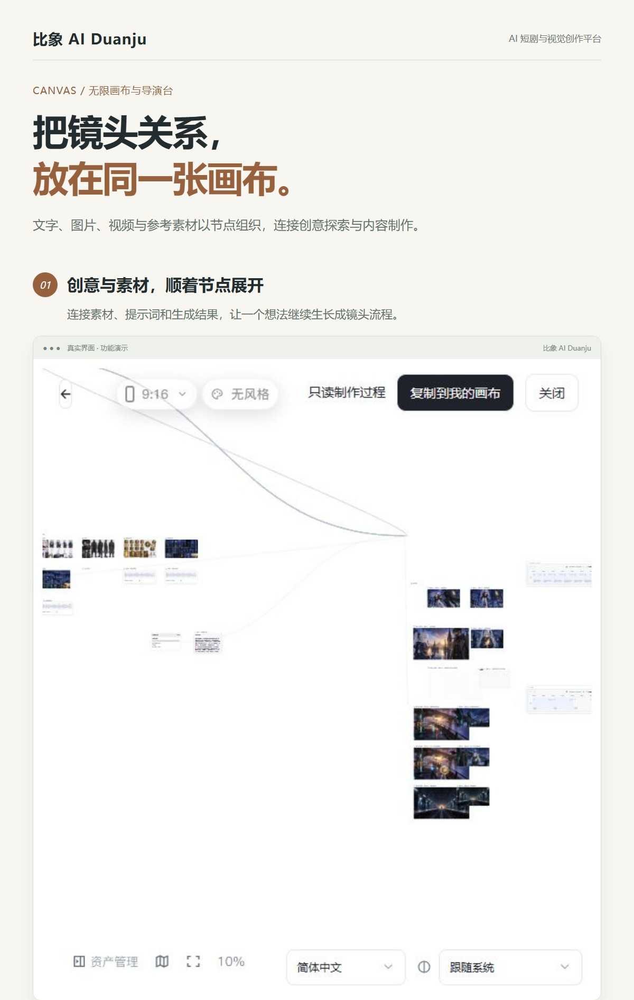

# 无限画布、一键成片与专业短剧怎么选

比象 AI Duanju 提供不同的创作入口。它们围绕故事与影像配合使用，但制作组织方式不同，适合按交付目标选择。

| 制作方式 | 更适合的目标 | 主要组织方式 |
| --- | --- | --- |
| 专业短剧 | 连载剧情、AI 漫剧、需要固定人物的分集故事 | 项目、角色场景资产、章节与分镜 |
| 无限画布 | 概念探索、参考素材、镜头试验、自定义生成关系 | 节点、连线与可复用素材 |
| 画布一键成片 | 叙事短片、品牌介绍、知识科普等完整视频任务 | 想法/已有剧本、生成设置与制作阶段 |

## 专业短剧：先确定资产，再推进分集

需要同一组人物反复出现、故事按集发展时，优先检查专业短剧流程。先维护角色与造型、场景和道具，然后检查分集剧本、镜头与视频制作。

它适合把制作问题定位到具体章节、资产和镜头。人物参考共享有助于统一制作依据，但并不替代生成结果的人工检查。

## 无限画布：让素材与生成关系可见

还在探索风格、试验提示词或比较不同镜头时，可以从画布开始。把文字、图像、视频和参考素材放在节点里，连接上下游关系，沿着已有结果继续创作。

导演台用于角色、场景和视角布局；时间线用于组织已有片段与声音。它们解决不同阶段的问题，不应把所有入口理解成相同的“一键生成”。

## 一键成片：从目标出发组织多个步骤

在画布成片入口选择叙事短片、品牌片或知识科普，再选择描述想法或已有剧本。带入参考资料、目标时长、语言和补充要求，配置策划、绘图与视频模型。

逐步确认适合希望检查关键阶段的创作者。智能托管适合要求较明确、模型与费用条件已准备好的任务。无论哪种模式，输出都应由创作者检查；不能把流程自动化理解成无需模型服务、无需费用或无需人工复核。

## 一个实际的选择过程

如果要制作有固定角色的五集故事，先在专业短剧中建立项目与资产。如果要为其中一个场景探索视觉风格，可以用画布试做参考镜头。如果要制作独立品牌介绍片，可以从品牌片成片流程直接描述目标并带入品牌资料。

不同入口之间能否直接迁移全部项目数据，以当前版本提供的操作为准。本介绍不承诺任意工程格式互导。

[返回产品介绍](../README.md) · [短剧制作教程](ai-short-drama-workflow.md) · [授权与交付](commercial-edition.md)
